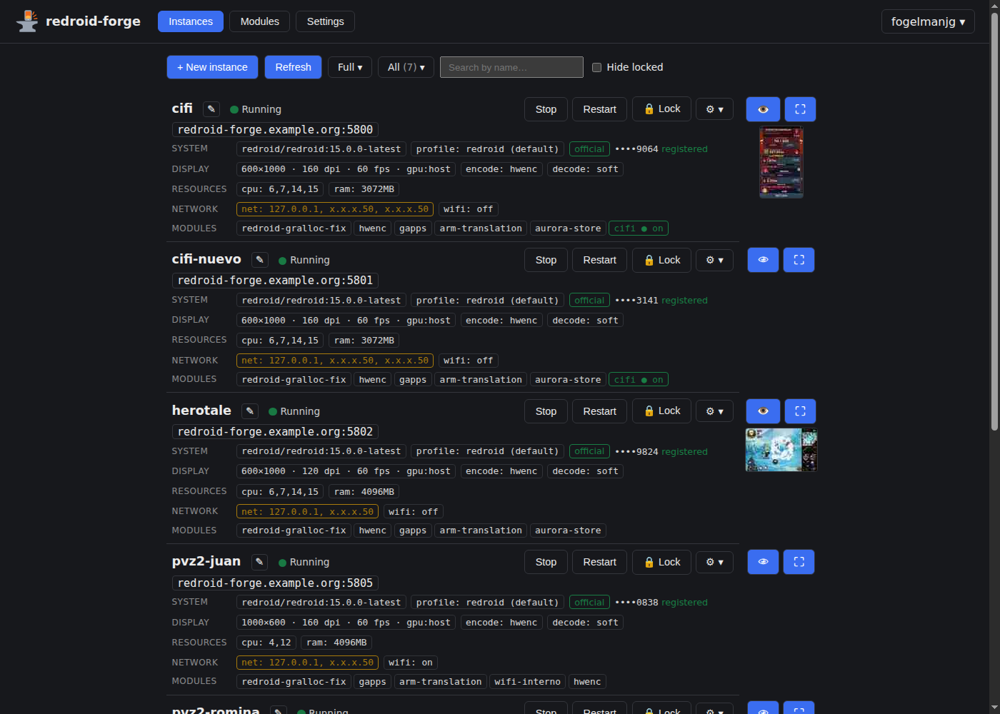
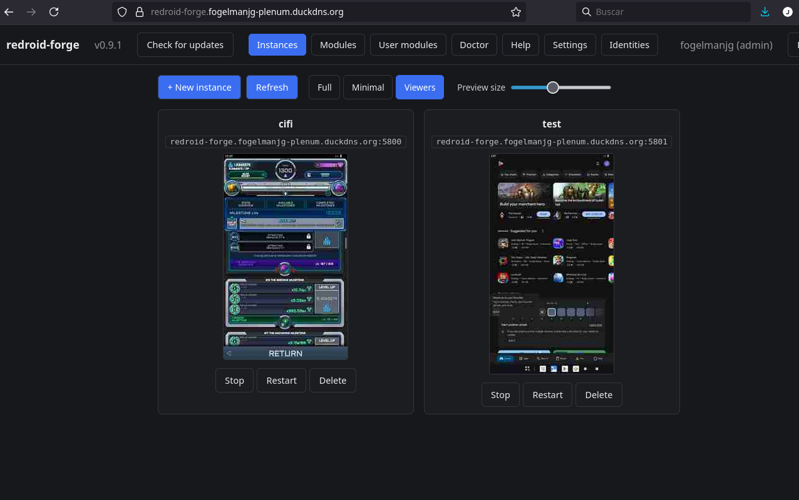
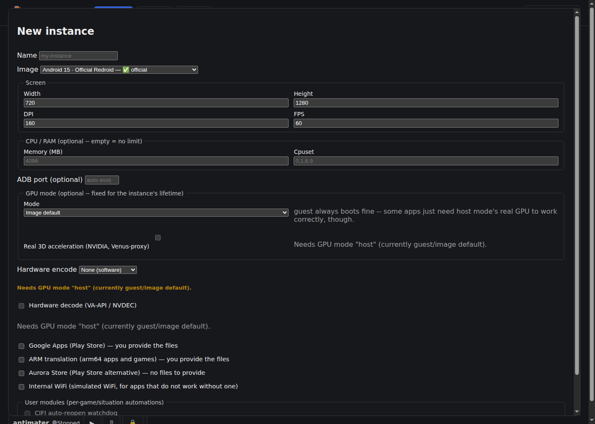

# redroid-forge

[](https://github.com/fogelmanjg/redroid-forge/releases)
[-brightgreen)](docs/KNOWN-COMBINATIONS.md)

**Languages:** English | [Español](README.es.md)

> This project's official language is **English**. The Spanish file is provided for convenience and
> may not be perfectly accurate or up to date — if in doubt, this file is the source of truth.

A standalone app (frontend + backend in a single container) to manage
[redroid](https://github.com/remote-android/redroid-doc) instances on any PC that only has Docker,
without depending on any other infrastructure.

> **Version 1.0** (02/12/2026). It replaces several separate projects with one: `redroid-manager`,
> `redroid-hwenc`, `redroid-nvidia`, and the redroid parts of `jg-dashboard` and `plenum-redroid`,
> which are now retired. For the full picture:
> - [`docs/REQUIREMENTS.md`](docs/REQUIREMENTS.md): what it does and why.
> - [`docs/ARCHITECTURE.md`](docs/ARCHITECTURE.md): how the pieces fit together (base image,
>   modules, and when each one acts in an instance's lifecycle).
> - [`docs/MODULE-AUTHORING.md`](docs/MODULE-AUTHORING.md): writing a module (native, own or user
>   module, the manifest schema, the 7-stage hook contract).
> - [`docs/ROADMAP.md`](docs/ROADMAP.md): how it got here, phase by phase.
> - [`CHANGELOG.md`](CHANGELOG.md): what changed in each release, and the versioning policy.
> - [`docs/UPSTREAM.md`](docs/UPSTREAM.md): the fixes offered back to redroid itself.
>
> What comes next is in the issues marked [After 1.0](https://github.com/fogelmanjg/redroid-forge/milestone/1),
> plus Phase 8 of the roadmap (federation: `jg-dashboard`/Plenum logging in through this app via
> `oidc`). How to propose a change is in [`CONTRIBUTING.md`](CONTRIBUTING.md).

## Screenshots

  

More in [`docs/SCREENSHOTS.md`](docs/SCREENSHOTS.md): the three Instances views, the instance
panels (Configure, Resources, port-knocking), modules, everything under Settings, and what each role
(admin, operator, viewer) sees.

## Features

What it does today, and what's still ahead. "Official" vs "community" below is this project's own
support-tier distinction (see [`docs/KNOWN-COMBINATIONS.md`](docs/KNOWN-COMBINATIONS.md)): official
means validated with evidence on real hardware, not a guarantee.

| | Status | |
|---|---|---|
| **Instance lifecycle** | ✅ | Create/start/stop/restart/delete from a web UI. Live CPU/RAM resize (no restart), and Android itself sees the new CPU count and RAM limit. Resolution/DPI/FPS/GPU-mode changes recreate the container but keep its data. |
| **Recovery from Android crashes** | ✅ | When Android restarts on its own inside an instance (a crash of `system_server`, e.g. from a video ad), the forge saves its logs and restarts the whole instance, so WiFi and everything set up at start come back. At most 3 times an hour. |
| **Fixes for known redroid bugs** | ✅ | Applied to each instance's own copy of the image, never to the image itself: the gralloc crash on 10-bit formats, video (YV12) crashing Android on AMD, Android seeing the host's CPUs, RAM and memory pressure instead of the container's. Each one is offered back to redroid, see [`docs/UPSTREAM.md`](docs/UPSTREAM.md). |
| **Hardware video encode** | ✅ AMD · Intel | VA-API, validated on real Polaris/Vega/Iris Xe hardware. "Every instance uses in hardware everything the host's GPU offers" — nothing hidden behind one fixed capability tier. |
| **Hardware video decode** | ✅ AMD · Intel | H.264/HEVC/VP9/VP8 depending on what the host's GPU actually supports (Doctor shows which). **Not recommended on AMD Polaris at the same time as hwenc** — known driver instability when both run concurrently (see `docs/ROADMAP.md` Phase 2); encode alone is unaffected. |
| | ✅ NVIDIA | Encode (NVENC) + 3D rendering (`venus3d`, required for `gpuMode: host` to boot at all on NVIDIA — see its own module README) validated end to end on real hardware: GTX 1050 Ti clean, RTX 4060 clean with a rare, transient, self-resolving texture/tiling artifact on a few frames of high-contrast screens (see `redroid-nvidia`'s `DEVLOG.md`, 2026-11-09 entry) — not a blocker in real use. Decode (VA-API) confirmed bit-exact on the GTX 1050 Ti; not yet independently re-run on the RTX 4060 (see `redroid-hwenc`'s own hardware-compatibility table). |
| **Compatibility database** | ✅ | Signed, versioned, anti-rollback database of which image+module combinations are actually validated. Checked automatically, shown per instance, never blocks — an unvalidated combo still runs, just marked "community". |
| **Optional modules, with consent** | ✅ | Google Apps/Play Store, ARM translation (arm64 apps on x86), Aurora Store, fake WiFi, device profile spoofing, GPU mode — each behind an explicit contract dialog the first time it's used, never silently enabled. |
| | 📝 planned | Magisk (manifest exists, no real integration yet). |
| **User-defined watchdogs** | ✅ pilot | Periodic per-instance scripts (pause/resume/status from the UI, no cron to hand-edit) — CIFI (a specific game's reconnection logic) ported and running as the first one; the mechanism is generic for more. |
| **Backup & restore** | ✅ | Whole-instance backup/restore (tar.gz via a throwaway container) in the background with progress, optionally stopping the instance for a consistent copy, per-instance retention, optional Android ID reset, a warning (never a block) when restoring onto an instance with different modules/GApps version. |
| **Access control** | ✅ | Three roles (admin/operator/viewer) with per-instance ownership. Pluggable: `none` (default, zero-friction), `local` (built-in accounts), `oidc` (any number of standard identity providers at once — Keycloak, Google, Plenum, another federation, ... — roles assigned here, never read from the provider), `both` (local accounts and OIDC on the same login screen). A local account can also be reached through a linked OIDC identity (opt-in, proven by logging into both at once — never by matching a claimed email). A setup wizard creates the first admin live from `none` mode, and a self-lockout guard keeps `local`/`both` from ever becoming a permanently closed door. A non-admin user links their own SSO login from **Settings → My account**. Switching modes and adding/editing/removing OIDC providers can both be done live from **Settings → Identities** — no `.env` edit needed — though a restart is still required to apply, same rule as every other setting in this app. |
| **Network exposure control** | ✅ | The app and every instance bind to `127.0.0.1` only, by default — `redroid` itself has no access control of its own. Opt into any specific interface (or all of them) per instance and for the app itself, from the UI; Docker/container-internal interfaces (`docker0`, `br-*`, `veth*`, ...) are filtered out of that picker by default, with an admin override. |
| **Doctor** | ✅ | Host diagnostics with the exact command to fix what's missing — it only diagnoses, never runs anything on its own. An admin sees every check; any other user sees only the checks about their own instances, plus a plain "ask your administrator" notice when a host check fails. |
| **Screen viewing** | ✅ | Bundled web viewer right in the Instances tab — own scrcpy-server protocol client, no third-party viewer embedded. A persistent small live preview per instance, and an opt-in full-screen expanded viewer with real video (H.264)/audio (Opus)/input. Also: a 📲 button that opens an instance in the real desktop scrcpy through a small local launcher (Linux, see [`docs/HOWTO.md`](docs/HOWTO.md)), scrcpy connector scripts (`connect.sh`/`connect.ps1`), and a port for viewing from an Android device itself. |
| **Federation** | 📝 planned | `jg-dashboard` and Plenum becoming consumers of this app via `oidc`, reusing each host's existing identity provider instead of a separate login. |
| **Port knocking** | ✅ | Per-instance, per-interface SPA (`fwknop`) gate for the ADB/scrcpy port, on top of the network controls above -- opened from the UI by an already-authenticated session, never by the connecting device. |

## Use cases

**Play an Android game on Linux, with real GPU acceleration.** Create an instance with `gpuMode:
host` and GApps enabled, install the game from the Play Store, connect with scrcpy (see
["Viewing the screen from another PC"](#viewing-the-screen-from-another-pc-scrcpy--eg-a-tv-with-an-old-laptop)
below) and play — the same host GPU that would run a native Android emulator drives the actual
rendering, not software fallback.

**Revive an old tablet or phone as a thin client.** The device itself does almost nothing: it just
needs a scrcpy-capable app (see [ScrcpyForAndroid](https://github.com/Miuzarte/ScrcpyForAndroid)
below) and a network path to the instance's ADB port. The instance — and everything it needs to
run well — lives on whatever PC actually has the CPU/GPU for it, so hardware that's too weak to
run modern Android itself is still plenty to just display one.

**Connect to a TV, with an old laptop as the "console".** Same idea, aimed at a living room: the
laptop only runs a scrcpy client (far lighter than running Android locally), the real instance
runs on a server with real resources, and the TV just shows whatever that laptop outputs over
HDMI. See the connector scripts below for making this a one-command launch instead of typing the
`adb connect`/`scrcpy` pair by hand every time.

**Build a farm for testing or automation.** Every action here goes through a plain HTTP API
(`GET`/`POST /api/instances`, …) — spin up and tear down instances from a script, run the same APK
across several Android versions, or drive an instance headlessly (no human ever opening a scrcpy
window) for a CI job or a bot. The **user-defined watchdog** mechanism (CIFI today) is built for
exactly this: a periodic per-instance check/action with no cron job to hand-edit per host, and the
same **backup/restore** mechanism that protects a personal instance's save data doubles as a way
to snapshot a known-good test environment and restore it between runs.

## ⚠️ Images with GApps: register the Android ID within 48 hours

Images with Google Apps (`hasGapps: true` in the catalog) receive an Android ID (GSF) from Google
as soon as they boot. **If that ID is not registered by hand at
[google.com/android/uncertified](https://www.google.com/android/uncertified) within 48 hours of
the first boot, Google blocks GApps access on that instance** — it is an uncertified device
(redroid), and that registration is the way to avoid the block. It is not something the
code can do on its own, it is a human step.

The app helps make sure it does not get overlooked:
- The **Instances** tab shows the Android ID of every instance with GApps, and a highlighted warning
  line with a direct link to register it and an "I already registered it" button while it is pending.
- **Settings → Doctor** lists as pending (⚠️, and ❌ if the deadline has passed) any GApps instance
  that is not registered.

## Third-party / non-free modules: a contract before enabling them

Everything that is not 100% free software (GApps, Magisk) or that depends on a choice of the host
(fake WiFi, device profile, GPU mode) is declared with a versioned **manifest** (one
`manifest.json` per module under `backend/src/modules/`) instead of having its own enablement
logic.
The backend never creates or starts an instance that requires a module without a current
acceptance of its manifest — if it is missing, it answers `428` with the pending contract, the
frontend shows it (the same generic dialog for all of them, `frontend/contracts.js`), and only
after it is accepted is the request retried. See **Modules** in the UI and section 5 of
[`docs/REQUIREMENTS.md`](docs/REQUIREMENTS.md) for the full detail (it includes `compatibleCon`:
a module is not offered if the chosen image does not support it).

## Host requirements

- Docker installed and its daemon running.
- A kernel with `binder` support (standard in recent Ubuntu kernels) and `binderfs` mountable at
  `/dev/binderfs`.
- If you will use images with fake WiFi (`needsHwsimWifi`): a loadable `mac80211_hwsim` module.
- If you want GPU acceleration (`gpuMode=host`): GPU drivers installed on the host.

There is no need to install Node, special sudoers entries, or anything else on the host — the
`redroid-forge` container itself runs `--privileged --pid=host --network=host` and does everything
from there.

## Bringing the redroid image to this PC

Most images in the catalog (including the default one, `redroid/redroid:15.0.0-latest`) are public
on Docker Hub — the simplest path, and the one that covers almost everyone, is just:

```bash
docker pull redroid/redroid:15.0.0-latest
```

(Settings → Doctor does this check for you and shows the exact command if it is missing — you do not
need to pull it by hand before starting the app, this is just here for reference.)

Only if the image you need is private/custom, or this host has no internet access, bring it over
by hand instead. If it was built on another machine:

```bash
docker save <image> | gzip > image.tar.gz
# copy the file to this PC, then:
gunzip -c image.tar.gz | docker load
```

Or, if it is pushed to your own registry:

```bash
docker pull <your-registry>/<image>
```

The catalog of known images lives in [`backend/images.json`](backend/images.json) — add any new
image there (id, Docker tag, label, `gpuMode`, `needsHwsimWifi`).

## Starting the app

```bash
git clone https://github.com/fogelmanjg/redroid-forge.git
cd redroid-forge
cp .env.example .env   # check PORT is free on this host, see the file's own comments
docker compose up -d --build
```

The UI is available at `http://<this-pc-ip>:8080` (or the port you set in `PORT`, since it runs in
`network_mode: host`). Go to **Settings → Doctor** first: it tells you exactly what is missing on
this host and the command to fix it before creating the first instance.

Running a second instance on a host that already has one (e.g. a disposable/dev deployment
alongside a stable one)? Clone into a differently-named directory instead of the default
`redroid-forge` (`git clone https://github.com/fogelmanjg/redroid-forge.git my-second-forge`) —
plain `git clone` syntax, nothing specific to this project. Each checkout is fully independent
(its own `docker-compose.yml`, `.env`, `backend/data/`) — just also set `CONTAINER_NAME` in the
second one's `.env` (e.g. `CONTAINER_NAME=redroid-forge-prod`), since the container name defaults
to the same `redroid-forge` for every checkout and two containers can't share one name.

Two more things a second checkout does NOT inherit from the first one, found live on server01
(10/11/2026) after each one caused a real failure there:

- **`ADB_PORT_START`/`ADB_PORT_END`** (`.env.example`) must be a range that is actually free on
  the host — not just non-overlapping with the first checkout's own range, but with anything else
  listening on this host at all (a completely unrelated process can already hold a port inside
  the default `5555`-`5595`). `docker create` only reports this as a raw "port is already
  allocated" once instance creation is already underway; the Doctor's "ADB port range
  availability" check now catches it ahead of time.
- **The optional modules' host data** (gapps, arm-translation, hwsim-wifi-overlay under
  `backend/data/`, plus any `REDROID_FORGE_*_DIR`/`REDROID_HWENC_ARTIFACTS_DIR` override pointing
  outside it) is local, gitignored content — a fresh checkout starts with none of it, even when a
  sibling checkout on the same host already has it. Copy the relevant `backend/data/<module>`
  folder(s) over from the existing checkout (or re-extract/re-provide them, see each module's own
  README) before creating an instance that needs them; each module fails with a clear, specific
  message naming the missing path/env var rather than a confusing crash, so check the instance
  creation error (or the Doctor) for exactly which one is missing.

## Screen viewing: the built-in web viewer

No install needed on the viewing side — open the Instances tab in a browser. Two modes, both
reusing the same access-control model as the rest of the app (`view` to watch, `start-stop` to
send input):

- **Live preview**: a small, persistent live preview per instance (periodic screenshots, not full
  video — it is meant to just be there, not to be fluid). In the **Full** view each instance has its
  own 👁 toggle; the **Viewers** view shows every running instance's preview at once, all the same
  size whatever their resolution, in a portrait band and a landscape band (by what is on screen right
  now — a game running in landscape on a portrait instance goes with the landscape ones).
- **Expanded viewer**: an opt-in full-screen mode with real streaming-quality video (H.264, decoded
  with `VideoDecoder`) and audio (Opus, `AudioDecoder`), plus input (click/tap, a hidden text
  field for typing, and a nav bar for back/home/recent-apps/volume). Reachable from the ⛶ button
  on each instance, in the Full and Viewers views.

Both drive the real `scrcpy-server.jar` this project pushes and launches on the instance itself —
own protocol client (`backend/src/lib/scrcpy/`), not an embedded third-party viewer. See
[`docs/ROADMAP.md`](docs/ROADMAP.md)'s Phase 11 for the full design and
[`CHANGELOG.md`](CHANGELOG.md) (`0.9.0` onwards) for what shipped when.

## Viewing the screen from another PC (scrcpy) — e.g. a TV with an old laptop

For a desktop-native client instead of the browser (lighter on an old laptop used purely as a
display, or for scripting), or from another Android device. On a Linux desktop, the simplest way is
the **📲** button with the local launcher installed (see
["Open an instance in scrcpy on your computer"](docs/HOWTO.md#open-an-instance-in-scrcpy-on-your-computer));
the rest of this section is the manual way:

scrcpy repository: https://github.com/Genymobile/scrcpy

Every instance exposes its ADB port on the host (`adbPort` in the `GET /api/instances` response;
the UI shows `host:port` under each instance's name, click it to copy). The host part is
**Settings → General → ADB address for clients** when set, else the name or IP you opened the page
with. From any other machine on the network that has scrcpy and `adb`:

```bash
adb connect <server-ip>:<adbPort>
scrcpy -s <server-ip>:<adbPort>
```

This is useful for reusing an old laptop + TV as a light "client": the laptop only runs `scrcpy`
(far less demanding than running Android locally), while the real instance runs on a server with
more resources. If the laptop is old and its distro ships an outdated `scrcpy` in its repositories
(Debian, for example, only has an old version in `backports`), downloading the newest official
binary from [GitHub Releases](https://github.com/Genymobile/scrcpy/releases) is usually simpler
than compiling it — note that the `scrcpy-server` version must match the `scrcpy` client's version
exactly.

### From an Android phone/tablet instead of a PC

If the client you have at hand is an Android device (not a PC/laptop), there is a scrcpy port that
runs as an Android app: **ScrcpyForAndroid** (https://github.com/Miuzarte/ScrcpyForAndroid).
Conceptually it is the same: the app connects over the network to the instance's ADB port
(`<server-ip>:<adbPort>`) and decodes the video there, without needing a PC in between.

### A connector script, instead of typing the command above every time

`scripts/connect.sh` (Linux/macOS) and `scripts/connect.ps1` (Windows PowerShell) read
`GET /api/instances` themselves, show a menu of the running ones (or your PC's own USB-connected
devices), remember your last pick, and launch `scrcpy` with the flags above already applied:

```bash
scripts/connect.sh                                          # defaults to http://localhost:8080
REDROID_FORGE_URL=http://<server-ip>:8080 scripts/connect.sh  # redroid-forge on another machine
```

```powershell
powershell -File scripts\connect.ps1
```

The connector script plus a scrcpy client has no extra dependency of its own on redroid-forge's
side (no Caddy, no reverse proxy, no auth stack beyond what the app already has) — that's not a
statement that those are incompatible with it, a reverse proxy or auth layer in front of
redroid-forge is entirely your own choice to run, redroid-forge just doesn't set one up or manage
one for you. If you want a nicer interactive client instead of (or alongside) these scripts, take
a look at
[**scrcpy-manager**](https://git.liaima.dev/liaima/scrcpy-manager) (a terminal UI with mouse
support, saved connection profiles, and multiple live scrcpy sessions at once) — a separate project
we don't bundle, but one of its ideas (recovering a fixed ADB port after a device reboot) is
reflected in these scripts.

First time hitting a scrcpy problem (no audio, choppy video, wrong bitrate)? See
[`docs/SCRCPY-TIPS.md`](docs/SCRCPY-TIPS.md) — the handful of gotchas that actually come up, plus
the shortcuts worth knowing, without the full manual. For problems with the app itself (instances,
the built-in viewer, resources) see [`docs/TROUBLESHOOTING.md`](docs/TROUBLESHOOTING.md); for
step-by-step recipes for common tasks see [`docs/HOWTO.md`](docs/HOWTO.md).

## Layout

```
backend/src/server.js    Express, serves /api/* and the static frontend
backend/src/lib/          dockerRuntime, binder, hwsimWifi, androidIdentity, doctor, store,
                           portAllocator, moduleManifests, moduleAcceptance, moduleGate, hwAccel,
                           knownDb*, permissions, userStore, session, oidc, auth, accountLinks,
                           roleAssignments, quotas, networkInterfaceFilter, settings
backend/src/routes/       instances, doctor, images, modules, db, settings, backups, network, auth,
                           viewer (live preview), viewerExpanded (expanded viewer, Phase 11)
backend/src/lib/scrcpy/   own scrcpy-server protocol client (Phase 11): protocol.js (wire format),
                           pushServer.js/launchServer.js (push+launch the real jar), forward.js,
                           the video/audio/control sockets, viewerSession.js (ties it all together),
                           opusTranscoder.js (PCM→Opus, no on-device Opus encoder exists -- see
                           docs/ROADMAP.md Phase 11)
backend/src/modules/      manifests/*.json (each module's contract, section 5 of REQUIREMENTS.md)
                           + one folder per real module (hwenc/, hwdec/, gapps/,
                           arm-translation/, wifi-interno/, redroid-gralloc-fix/, cifi/):
                           integration script, not just a manifest
backend/native/           vaapi-daemon — host daemon of the hwenc/hwdec modules (see docs/ARCHITECTURE.md)
backend/db/               bundled seed of the known-combinations database + trusted signing keys
backend/images.json       catalog of the available redroid images
backend/data/             persistent state (instances.json, settings.json, users.json, ...)
backend/test/             tests (node --test, no new dependencies)
android/                  Codec2 components (hardware encoder/decoders) and their test tools
frontend/                 vanilla frontend (no build step); contracts.js = generic contract modal,
                           authUi.js = login gate + per-capability UI hide/disable (Phase 7),
                           viewer.js/viewerExpanded.js = the two built-in viewer modes (Phase 11),
                           instanceFilter.js/viewersLayout.js = the Instances filter and the
                           Viewers layout, scrcpyLauncher.js = the 📲 local-scrcpy test/toggle
launcher/linux/           the local scrcpy launcher (handler of scrcpy-redroid:// links), served by
                          the app at /launcher/linux/ for installing on a desktop
scripts/                 connect.sh / connect.ps1 -- scrcpy connector scripts for end users (not
                          backend/scripts/, which is dev/admin-time tooling)
docs/                     REQUIREMENTS.md (what and why), ARCHITECTURE.md (how the pieces fit
                          together), MODULE-AUTHORING.md (writing a module), KNOWN-COMBINATIONS.md,
                          ROADMAP.md (in what order), SCRCPY-TIPS.md (client-side troubleshooting),
                          TROUBLESHOOTING.md (app-side problems), HOWTO.md (common task recipes),
                          SCREENSHOTS.md (the gallery) and UPSTREAM.md (fixes offered to redroid)
CHANGELOG.md              tagged releases, SemVer policy (English only, same reasoning as ROADMAP.md)
CONTRIBUTING.md           how to propose a change, what is being merged, bug report/module checklist
.github/ISSUE_TEMPLATE/   bug report / feature request forms
```

## Credits and attribution

This project is a frontend/manager on top of what other projects have already built — not a
replacement or a competitor. Explicit acknowledgement:

- **[redroid](https://github.com/remote-android/redroid-doc)** (remote-android) — the
  Android-in-Docker itself that all of this runs on. Apache License 2.0 (kernel modules under
  GPL v2).
- **[scrcpy](https://github.com/Genymobile/scrcpy)** (Genymobile) — Apache License 2.0. The
  built-in web viewer's expanded mode pushes and launches the real `scrcpy-server` binary from
  that project on each instance — downloaded and `sha256`-verified from its official GitHub
  release at image build time (see `Dockerfile`, pinned version), not forked or copied.
  `backend/src/lib/scrcpy/protocol.js` is this project's own client of that server's real wire
  protocol, written against its public source.
- Where this project works around a bug of redroid itself, the fix is offered back upstream with
  code and tests on real hardware; [`docs/UPSTREAM.md`](docs/UPSTREAM.md) tracks each one.
- The logic of `binder.js` and `hwsimWifi.js` is ported from `plenum-redroid`
  (`host-resource-allocator.service.ts` and `fake-wifi-networking.service.ts`), simplified:
  without the coexistence assumptions with `jg-dashboard v1` (fixed port offset, hwsim fallback
  disabled) that do not apply in a single-purpose deploy like this one.

## License

Apache License 2.0 — see [`LICENSE`](LICENSE).
