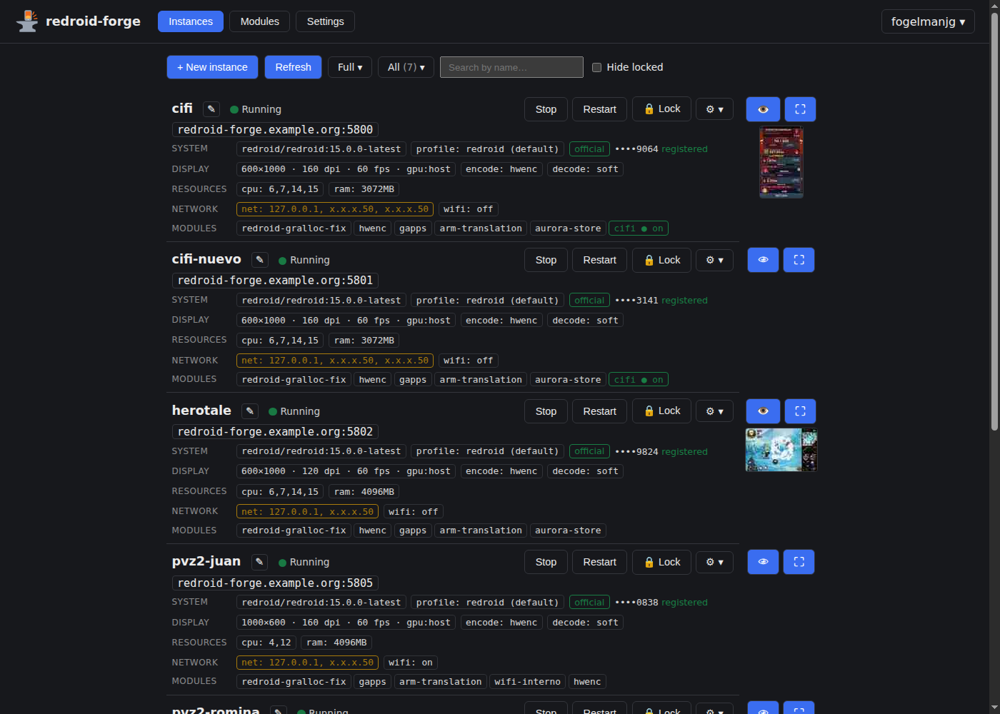
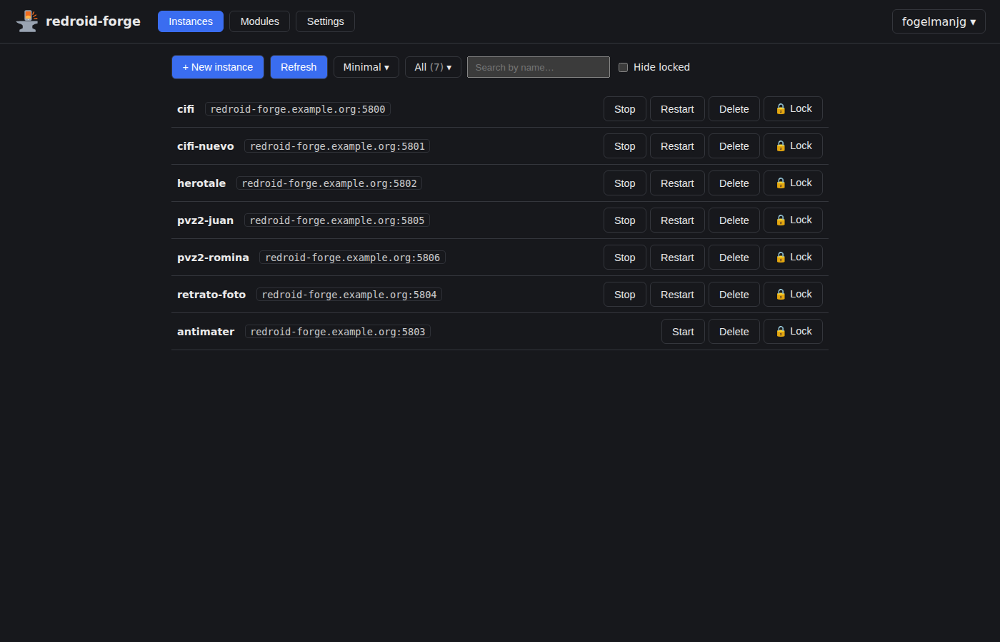
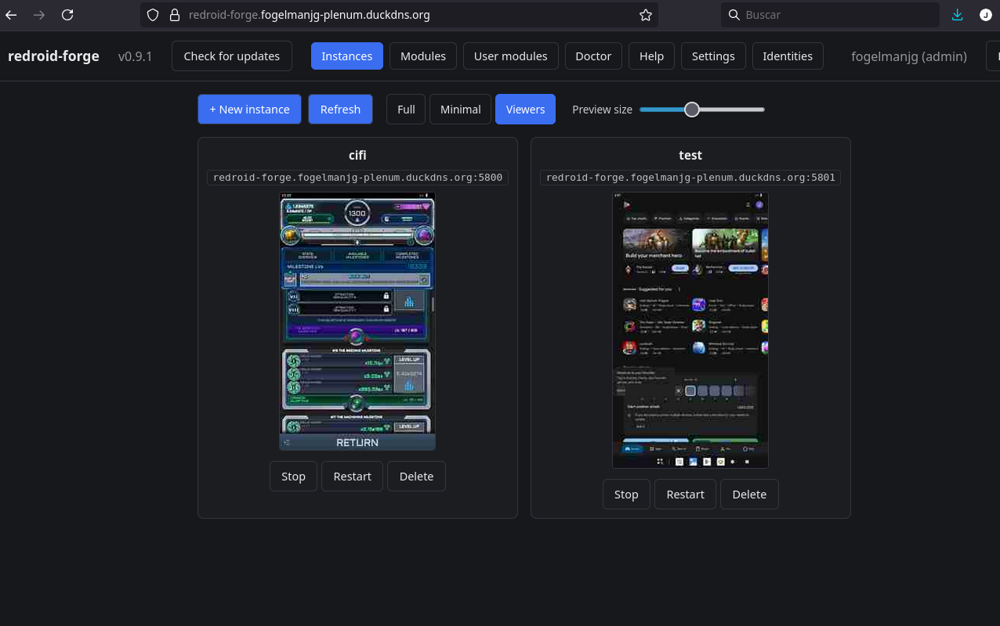
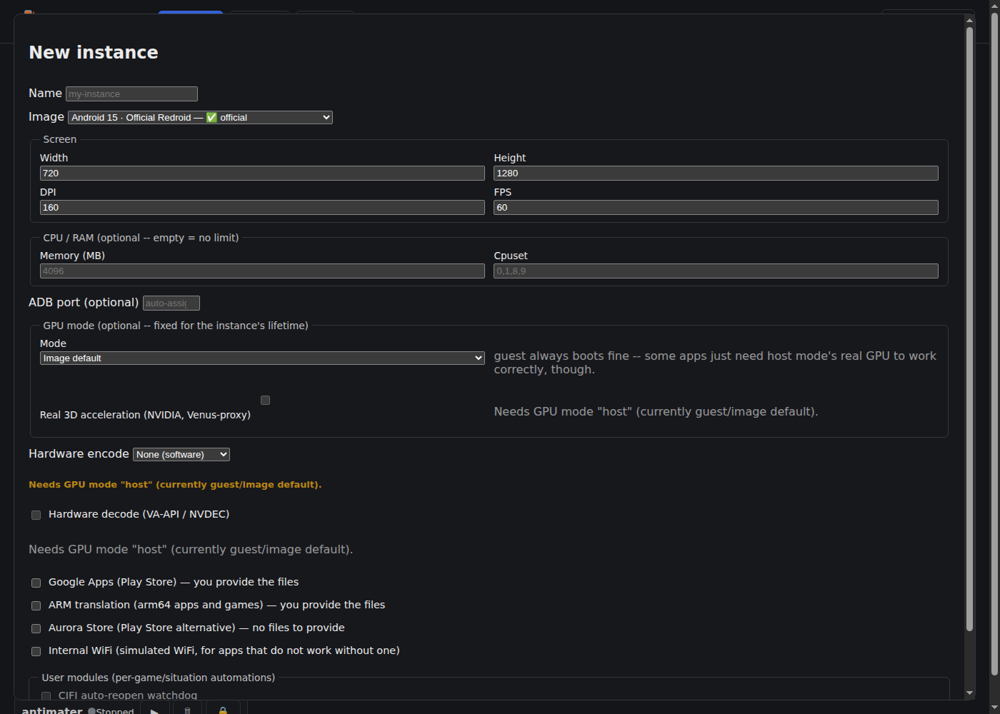
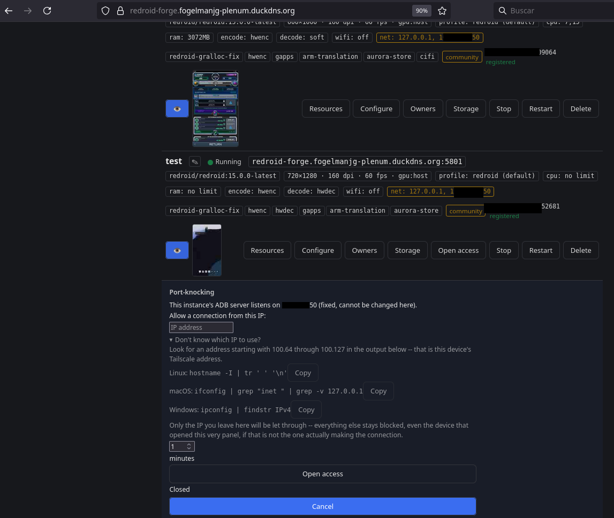
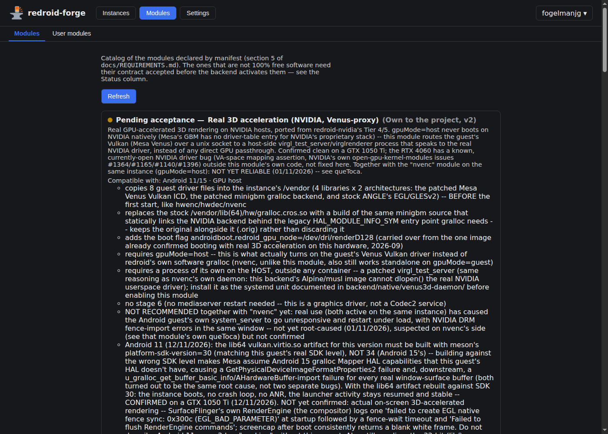
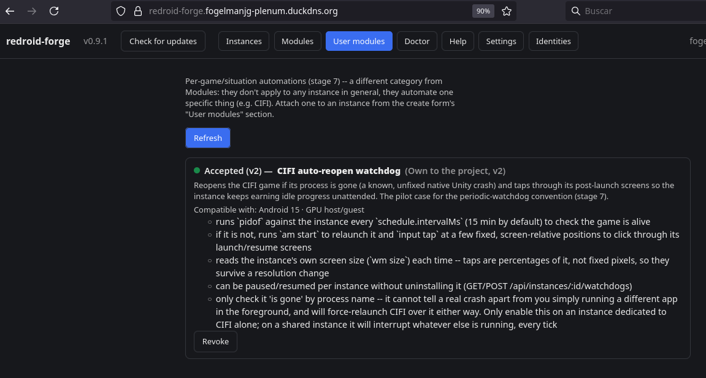
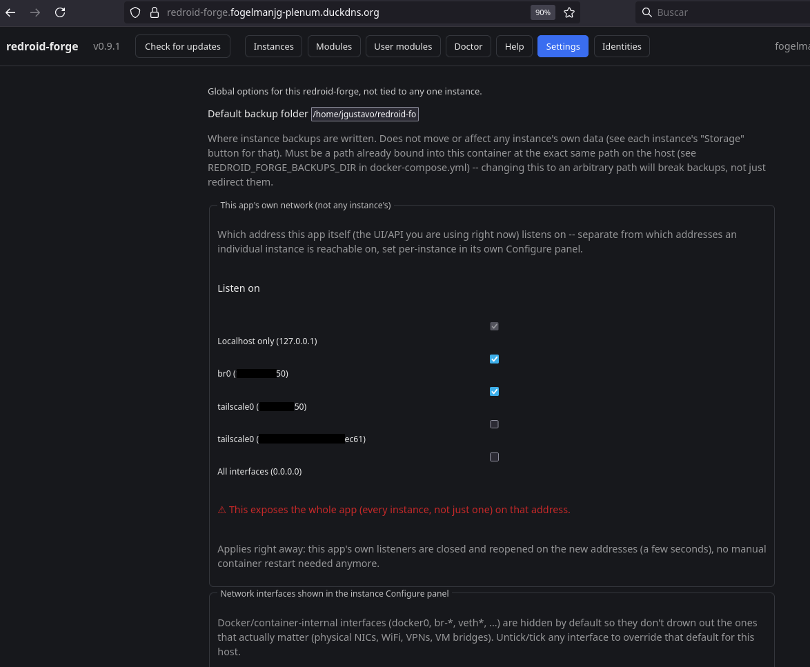
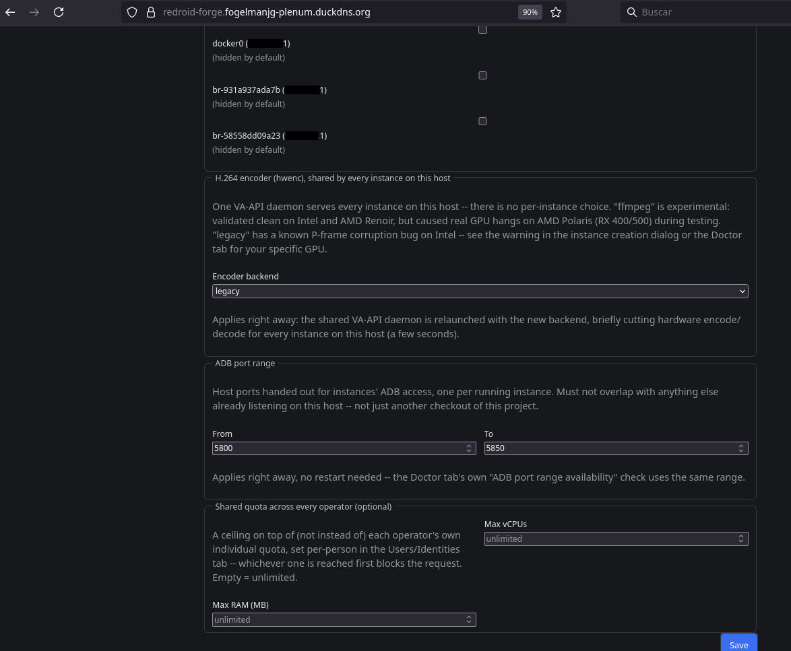
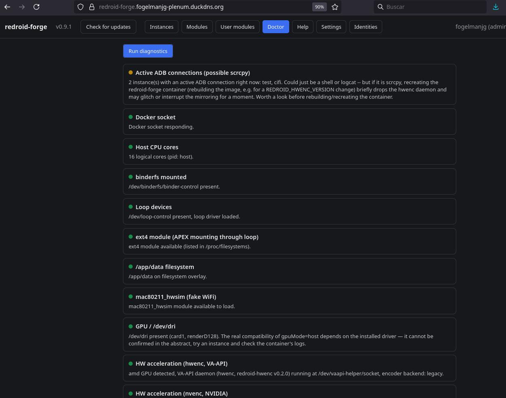

# Capturas de pantalla

**Idiomas:** [English](SCREENSHOTS.md) | Español

Algunos datos de la interfaz están borroneados en estas imágenes (parte de una dirección IP o de un
ID de cuenta, dejando visible lo justo para saber qué es) — son datos de esta máquina, no algo que
haga la app.

El encabezado tiene tres grupos — **Instancias**, **Módulos** y **Configuración** — con las pestañas
del grupo abierto en una fila debajo, y un menú a la derecha con el usuario, la versión y el chequeo
de actualizaciones, Ayuda, el idioma y cerrar sesión.

## Instancias

Tres vistas, elegidas en el desplegable de vista y recordadas por navegador. Al lado, un desplegable
de estado (todas / activas / detenidas, con la cantidad de cada una), una búsqueda por nombre y
"ocultar bloqueadas".

### Completo (por defecto)

Una tarjeta por instancia: nombre, estado y los botones de uso diario en la primera línea, la
dirección ADB debajo (un clic la copia), una línea resaltada cuando hay un Android ID esperando ser
registrado, y la información en renglones con título — Sistema, Pantalla, Recursos, Red, Módulos.
Recursos, Configurar, Dueños, Almacenamiento, Acceso ADB y Borrar están en el menú ⚙. El botón 👁
muestra una vista previa en vivo.

### Mínimo

Solo nombre, dirección y acciones — para un host con muchas instancias, o una ventana angosta.

### Visores

La vista previa en vivo de todas las instancias en ejecución a la vez, todas del mismo tamaño sea
cual sea su resolución, en dos bandas: retrato y después paisaje (según lo que hay en pantalla
ahora). El deslizador fija el tamaño (el lado largo, 200-600 px); "Ajustar al ancho" pone cada banda
en una sola fila. Las instancias detenidas aparecen debajo como tarjetas chicas, con un botón para
arrancarlas.

## Crear una instancia

Resolución, DPI/FPS, límites de CPU/RAM, modo GPU, encode/decode por hardware, y los módulos
opcionales (GApps, traducción ARM, Aurora Store, WiFi falso) — todo desde un mismo formulario, con
la imagen elegida por defecto según cuál esté marcada como "oficial" para este host.

## Exposición de red por instancia

En qué interfaces se puede llegar a esta instancia en particular (⚙ → Configurar) — aparte de en qué
interfaces escucha la app en sí (eso está en Configuración → General, más abajo).

## Port-knocking (acceso abierto)

Una ventana de acceso con tiempo y IP limitados al puerto ADB de una instancia — se abre desde una
sesión ya logueada, nunca desde el dispositivo que se conecta.

## Módulos

Funciones opcionales por instancia, cada una detrás de su propio contrato explícito la primera vez
que se activa.

### Módulos de usuario

Automatizaciones propias por instancia (por ejemplo un watchdog de reconexión) — la contraparte
escrita por el usuario de los módulos incluidos de arriba.

## Configuración

### General

Opciones globales, no atadas a ninguna instancia: la red de la propia app, la dirección ADB que se
muestra a los clientes, la carpeta compartida de backups, qué interfaces del host aparecen en el
selector de cada instancia, el backend compartido del encoder por hardware, el rango de puertos ADB,
y cuotas opcionales. Solo admin.

### scrcpy local

Se prueba el lanzador local una vez en este navegador y después se activa o desactiva el botón 📲
(ver [`HOWTO.es.md`](HOWTO.es.md#abrir-una-instancia-en-scrcpy-en-tu-computadora)).

### Doctor

Diagnóstico del host, el peor estado primero (rojo, después amarillo, después verde) — cada chequeo
trae el comando exacto para arreglarlo, nunca ejecuta nada solo. Un usuario que no es admin ve solo
los chequeos de sus propias instancias.

### Identidades / Mi cuenta

Admins: cuentas locales y cualquier cantidad de proveedores OIDC a la vez, lado a lado — una cuenta
local puede vincularse a una identidad de un proveedor, y cada identidad vinculada se maneja por
separado. Cualquier otro usuario ve **Mi cuenta** en su lugar, para vincular o desvincular su propio
login SSO.

