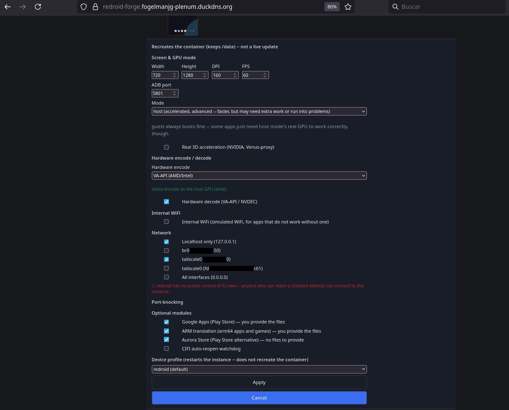
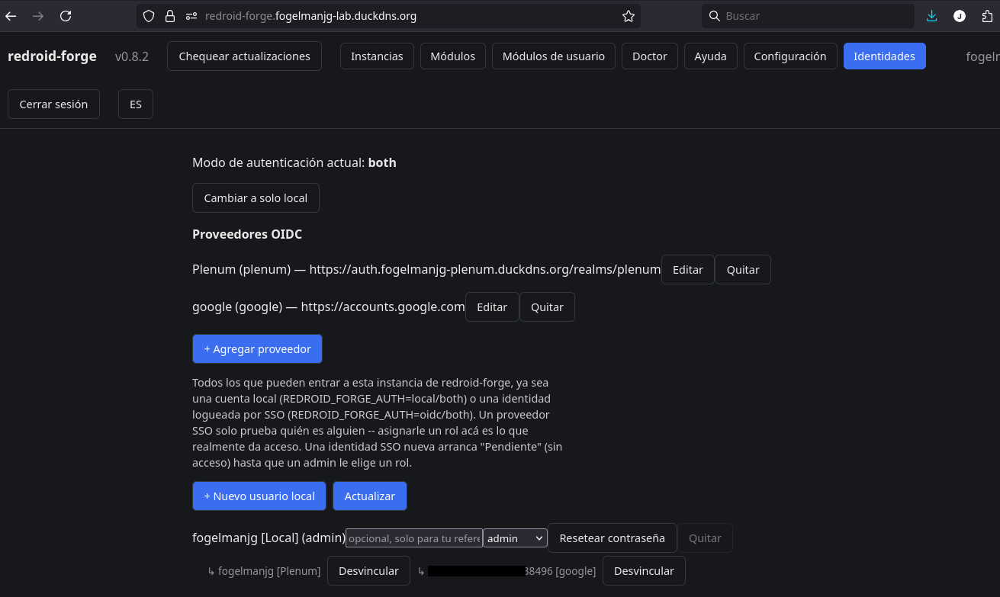

# Capturas de pantalla

**Idiomas:** [English](SCREENSHOTS.md) | Español

Algunos detalles de la interfaz están difuminados/tapados en estas imágenes (parte de una
dirección IP o un ID de cuenta, dejando visible lo justo para que se note qué es) — es un dato de
esta máquina en particular, no algo que hace la app.

## Pestaña Instancias

Tres modos de vista, a elección de cada usuario, recordados entre recargas.

### Completo (por defecto)

La tabla completa — un par de filas por instancia, estadísticas en vivo (CPU/RAM, backend de
encode/decode, red, módulos, estado de registro) y todas las acciones, a mano.

### Mínimo

Solo nombre, dirección y acciones — para un host con muchas instancias, o una ventana angosta.

### Visores

Una grilla de vistas previas en vivo, una por instancia, redimensionable al vuelo (el slider habla
con el backend en vivo, sin recargar la página) — todo de un vistazo sin entrar a cada instancia.

## Crear una instancia

Resolución, DPI/FPS, límites de CPU/RAM, modo de GPU, encode/decode por hardware, y los módulos
opcionales (GApps, traducción ARM, Aurora Store, WiFi falso) — todo desde un mismo formulario, con
la imagen por defecto apuntando siempre al nivel marcado "oficial" para este host.

## Exposición de red por instancia

En qué interfaces es alcanzable esta instancia puntual — distinto de en qué interfaces escucha la
app en sí (eso está en Configuración, más abajo).

## Port-knocking (acceso abierto)

Una ventana de acceso acotada en tiempo y en IP para el puerto ADB de una instancia — se abre desde
una sesión ya logueada, nunca desde el dispositivo que se quiere conectar.

## Doctor

Diagnóstico del host, peor estado primero (rojo, luego amarillo, luego verde) — cada chequeo trae
el comando exacto para solucionarlo, nunca ejecuta nada por su cuenta.

## Módulos

Funciones opcionales por instancia, cada una detrás de su propio contrato explícito la primera vez
que se activa.

## Módulos de usuario

Automatizaciones propias por instancia (ej. un watchdog de reconexión) — la contraparte hecha por
el usuario de los módulos incorporados de arriba.

## Configuración

Opciones globales, no atadas a ninguna instancia: la red propia de esta app, la carpeta de backups
compartida, qué interfaces del host aparecen en el selector por instancia, el backend de encoder
de hardware compartido, el rango de puertos ADB, y cupos opcionales.

## Identidades

Cuentas locales y cualquier cantidad de proveedores OIDC a la vez, lado a lado — una cuenta local
se puede vincular a una identidad de un proveedor, y cada identidad vinculada se administra por
separado.

