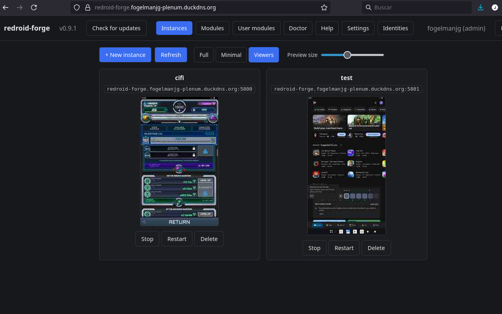

# Screenshots

**Languages:** English | [Español](SCREENSHOTS.es.md)

A few UI details are blurred/redacted in these images (part of an IP address or an account ID,
keeping just enough of it visible to tell what it is) — that's this machine's own data, not
something the app does.

## Instances tab

Three view modes, picked per user and remembered across reloads.

### Completo (default)

The full table — one row pair per instance, live stats (CPU/RAM, encode/decode backend, network,
modules, registration status) and all actions, right there.

### Mínimo

Just name, address and actions — for a host with many instances, or a narrow window.

### Visores

A live preview grid, one tile per instance, resizable on the fly (the slider talks to the backend
live, no page reload) — everything at a glance without opening each instance.

## Creating an instance

Resolution, DPI/FPS, CPU/RAM limits, GPU mode, hardware encode/decode, and the optional modules
(GApps, ARM translation, Aurora Store, fake WiFi) — all from one form, with the image defaulting to
whichever tier is tagged "official" for this host.

## Per-instance network exposure

Which interfaces this specific instance is reachable on — separate from which interfaces the app
itself listens on (that's in Settings, below).

## Port-knocking (open access)

A time-limited, IP-scoped access window for an instance's ADB port — opened from an already
logged-in session, never by the connecting device itself.

## Doctor

Host diagnostics, worst status first (red, then yellow, then green) — each check comes with the
exact command to fix it, never runs anything on its own.

## Modules

Optional per-instance features, each behind its own explicit contract the first time it's enabled.

## User modules

Per-instance custom automations (e.g. a reconnection watchdog) — the user-authored counterpart to
the built-in modules above.

## Settings

Global options, not tied to any one instance: this app's own network, the shared backup folder,
which host interfaces show up in the per-instance picker, the shared hardware encoder backend, the
ADB port range, and optional quotas.

## Identities

Local accounts and any number of OIDC providers at once, side by side — a local account can be
linked to a provider identity, and each linked identity can be managed independently.

