# Screenshots

**Languages:** English | [Español](SCREENSHOTS.es.md)

A few UI details are blurred/redacted in these images (part of an IP address or an account ID,
keeping just enough of it visible to tell what it is) — that's this machine's own data, not
something the app does.

The header has three groups — **Instances**, **Modules** and **Settings** — with the open group's
tabs in a row below, and a menu on the right with the user, the version and update check, Help, the
language and log out.

## Instances

Three views, picked from the view dropdown and remembered per browser. Next to it, a dropdown for
the state (all / active / stopped, with counts), a search by name and "hide locked".

### Full (default)

One card per instance: name, state and the everyday buttons on the first line, the ADB address
under it (click to copy), a highlighted line when an Android ID is waiting to be registered, and the
information in labeled lines — System, Display, Resources, Network, Modules. Resources, Configure,
Owners, Storage, ADB access and Delete are in the ⚙ menu. The 👁 toggle shows a live preview.

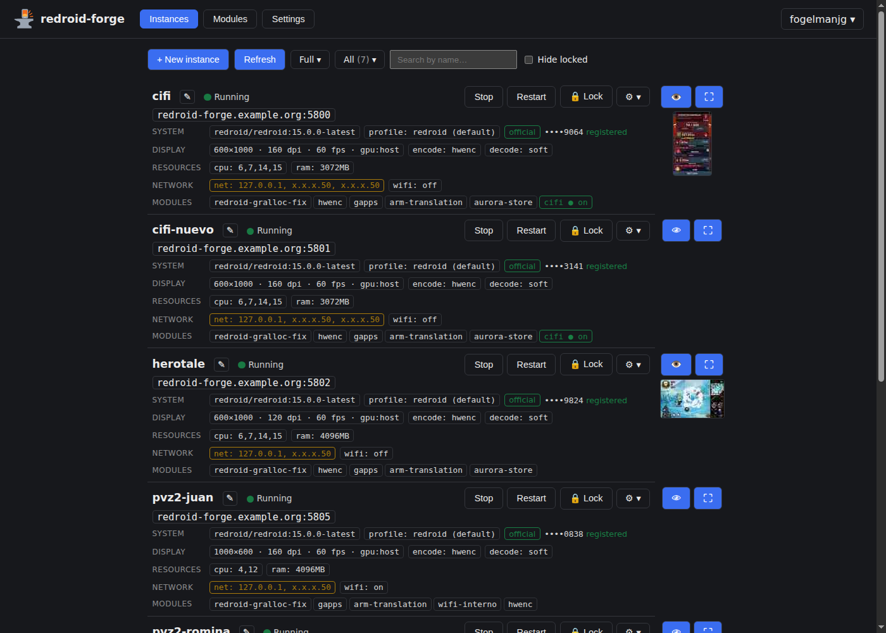

### Minimal

Just name, address and actions — for a host with many instances, or a narrow window.

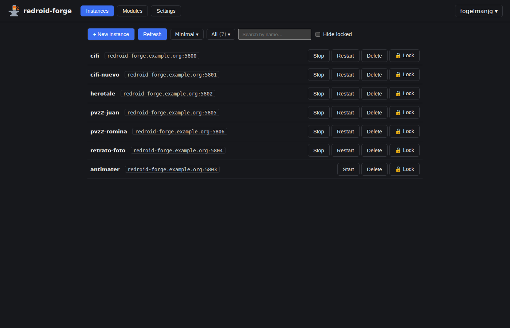

### Viewers

Every running instance's live preview at once, all the same size whatever their resolution, in two
bands: portrait, then landscape (by what is on screen right now). The slider sets the size (the long
side, 200-600 px); "Fit to width" puts each band in one row. Stopped instances are small cards
underneath, with a start button.

## Creating an instance

Resolution, DPI/FPS, CPU/RAM limits, GPU mode, hardware encode/decode, and the optional modules
(GApps, ARM translation, Aurora Store, fake WiFi) — all from one form, with the image defaulting to
whichever tier is tagged "official" for this host.

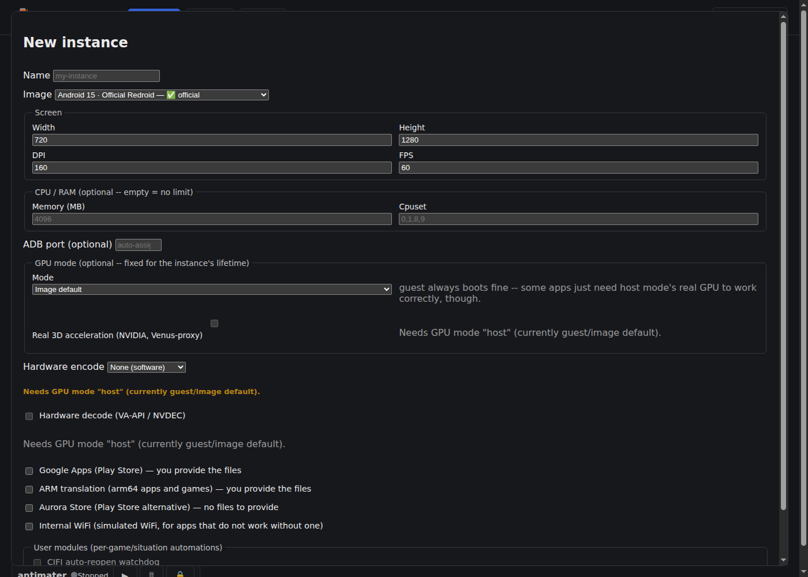

## Per-instance network exposure

Which interfaces this specific instance is reachable on (⚙ → Configure) — separate from which
interfaces the app itself listens on (that's in Settings → General, below).

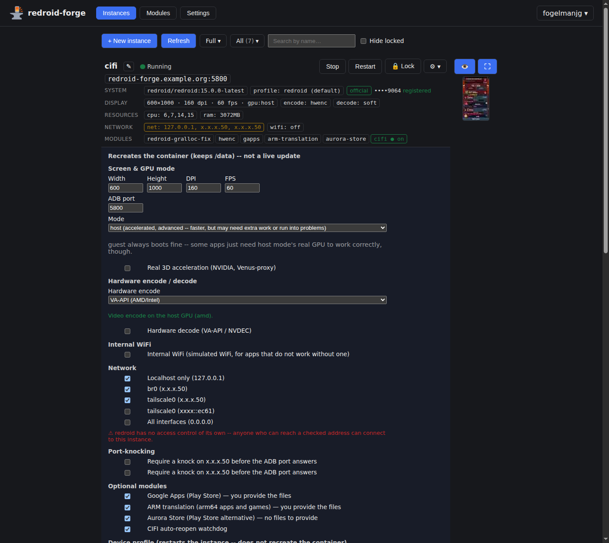

## Port-knocking (open access)

A time-limited, IP-scoped access window for an instance's ADB port — opened from an already
logged-in session, never by the connecting device itself.

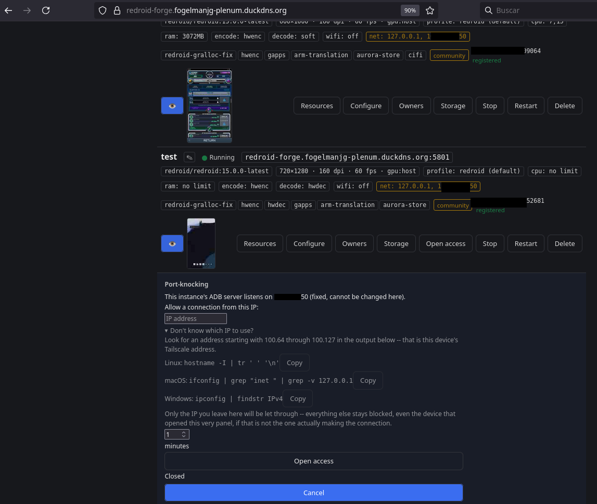

## Modules

Optional per-instance features, each behind its own explicit contract the first time it's enabled.

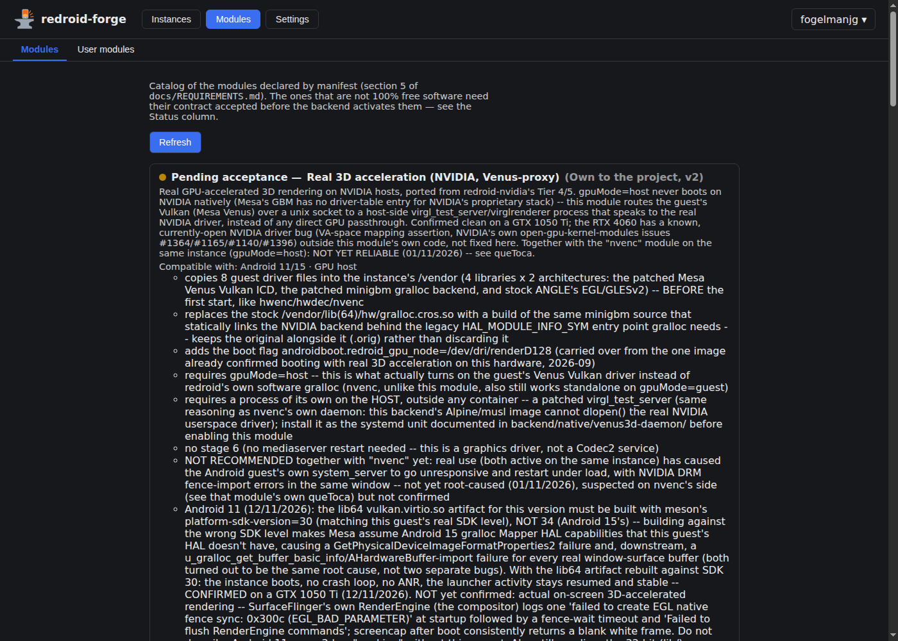

### User modules

Per-instance custom automations (e.g. a reconnection watchdog) — the user-authored counterpart to
the built-in modules above.

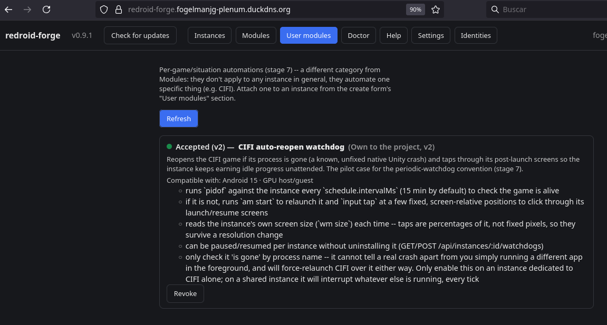

## Settings

### General

Global options, not tied to any one instance: this app's own network, the ADB address shown to
clients, the shared backup folder, which host interfaces show up in the per-instance picker, the
shared hardware encoder backend, the ADB port range, and optional quotas. Admin only.

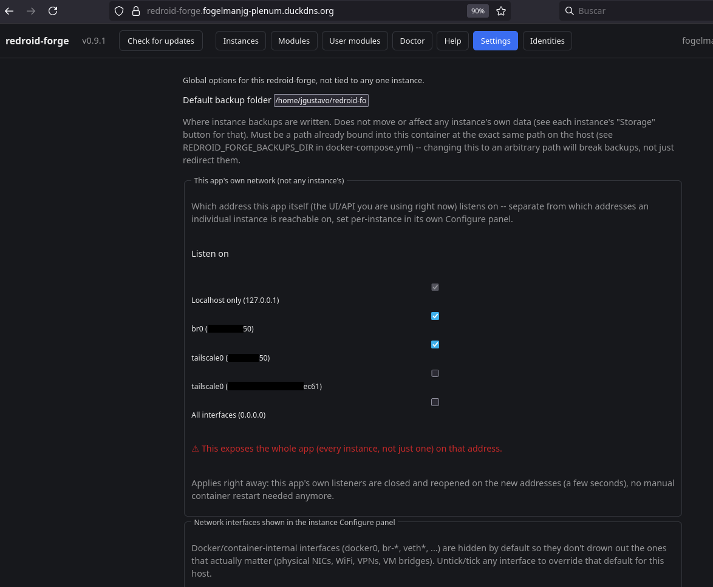
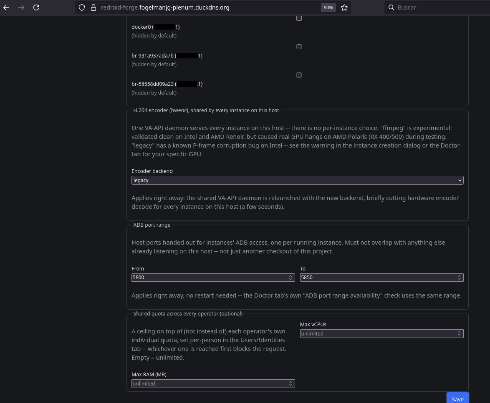

### Local scrcpy

Test the local launcher once in this browser, then turn the 📲 button on or off (see
[`HOWTO.md`](HOWTO.md#open-an-instance-in-scrcpy-on-your-computer)).

### Doctor

Host diagnostics, worst status first (red, then yellow, then green) — each check comes with the
exact command to fix it, never runs anything on its own. A non-admin user sees only the checks about
their own instances.

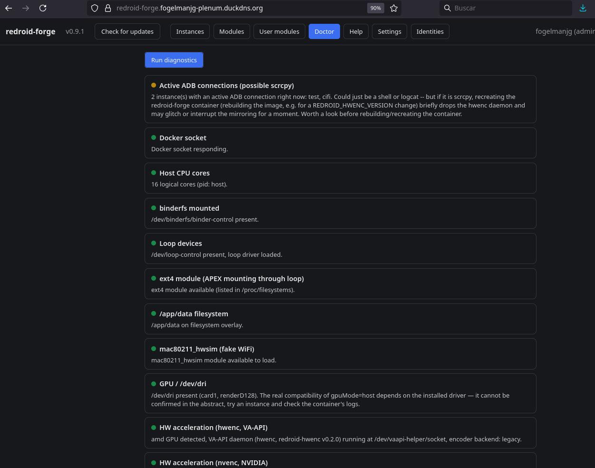

### Identities / My account

Admins: local accounts and any number of OIDC providers at once, side by side — a local account can
be linked to a provider identity, and each linked identity can be managed independently. Any other
user sees **My account** instead, to link or unlink their own SSO login.

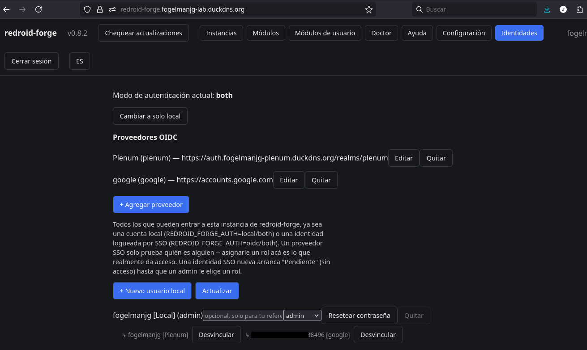
